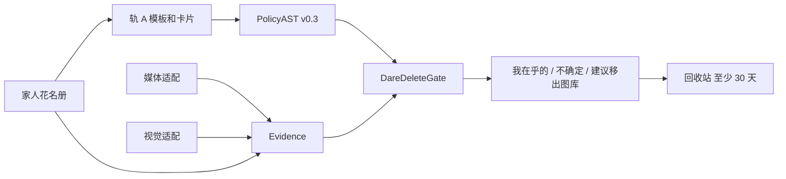

# 架构

体验版只做一件事：把一小撮照片和视频分成三桶，并在用户确认后放进应用自己的回收站。

## 包

| 路径 | 职责 |
| --- | --- |
| `packages/core` | 可单测的规则。没有图库、没有网络、没有像素。 |
| `apps/harmony` | HarmonyOS NEXT / API 12 的 ArkTS 壳。页面走适配接口。 |
| `apps/android`、`apps/ios` | 只有说明，还没有工程。 |

壳不能直接引用 TypeScript 包。`apps/harmony` 里的 `LocalEngine` 按同一判定顺序实现轨 A 和闸门，方便演示样例在 DevEco 里跑起来。单测以 `packages/core` 为准。

## PolicyAST v0.3

轨 A 的编译结果。轨 B（自由语句交给模型）不在这个版本里。

| 字段 | 含义 |
| --- | --- |
| `version` | 固定 `"0.3"` |
| `track` | 固定 `"A"` |
| `scope.media` | `photo`、`video` 或 `any` |
| `videoFirst` | 为真时，每桶里视频排在照片前面。不因此隐藏照片。 |
| `keep` | `OR(has_person)`。认出其中任何一位，就留在「我在乎的」。 |
| `deleteIfAbsent` | 和 `keep` 同一组人。缺席只是「建议移出」的必要条件。 |
| `unresolvedPersons` | 句子或卡片里还没建档完成的人。 |
| `executableDelete` | 有未完成的人、有看不懂的句子，或还没有在乎的人时为假。 |
| `thresholds.epsilon` | 默认 `0.2`。`P(has_family)` 必须小于它，才可能建议移出。 |
| `thresholds.tau` | 默认 `0.85`。覆盖必须达到它，才可能建议移出。 |

模板例子：

- `保留有妈妈的`
- `保留有妈妈的视频`
- `没有爸爸的可以建议移出`
- `只看视频`
- 多句用 `；` 分开

卡片极性：

- `keep`：这个人在乎
- `suggest_remove`：这个人缺席时可以考虑建议移出；一旦认出，仍然留下

看不懂的句子不会变成「全部可删」。矛盾的范围（又说只看视频、又说只看照片）也会关掉建议移出。

## 花名册

每个人要有至少 3 个原型才算建档完成。原型是 `fixture://` 指针加一个确定的向量，用来在没有设备接口时做匹配。`http` 地址会被拒绝。

没建档完成的人出现在意图里时，`executableDelete` 为假。闸门可以仍把认出的家人放进「我在乎的」，但不会产出任何 `delete_cand`。

## 闸门

按这个顺序，命中就停：

1. 不在本次范围 → 跳过，不进任何一桶。
2. 认出在乎的人，且概率 ≥ ε → `keep`。覆盖低、旁边还有未识别的脸，也不改变这一步。
3. 意图不可执行 → `uncertain`。
4. 有未识别的脸 → `uncertain`。
5. 覆盖 < τ → `uncertain`。
6. `P(has_family)` ≥ ε，但这个人不在「在乎」里 → `uncertain`。
7. 其余 → `delete_cand`。

`delete_cand` 只表示建议。没有任何函数会因为时间到了就删掉媒体。

## 回收站

`hold` 必须带 `userConfirmed: true`。`earliestReleaseAt` 是放入时间加 30 天。`restore` 把状态改回 `restored`。满 30 天只表示以后可以再问一次，本版本没有清除动作，也没有定时任务。

## 鸿蒙适配

| 接口 | 演示样例 | 真机 |
| --- | --- | --- |
| `MediaLibraryPort` | 返回 10 条内置 id | 空列表。以后用 `@kit.MediaLibraryKit` 的 `photoAccessHelper.getAssets`，或 `PhotoViewPicker` |
| `VisionPort` | 返回样例上的脸和覆盖 | 覆盖 0、未识别。以后用 `@kit.CoreVisionKit` 的 `faceDetector.detect` |

真机实现即使接上，观察结果在匹配完成前也应保持「不确定」，避免适配层自己把内容送进可删候选。系统图库的删除接口不调用。

## DEMO_FIXTURE

`runDemoFixture()` 使用固定的三位家人和 10 条媒体，走完：建档 → 意图 → 三桶 → 放进回收站 → 恢复第一条。媒体 id 与鸿蒙 `FixtureData.ets` 对齐。没有像素文件。
